# TRAIN_YOLO26 — Detección de eventos de riesgo con YOLO26

Entrenamiento de detectores **YOLO26n** para un sistema de videovigilancia inteligente
(tesis UCSM — Universidad Católica de Santa María). El repositorio documenta **tres
entrenamientos** realizados sobre datasets propios alojados en Roboflow, desde una primera
versión exploratoria de 22 clases hasta el **modelo final de 5 clases** que es el que se
despliega en producción.

| Modelo | Dataset | Clases | Imágenes | Épocas | mAP@0.50 | mAP@0.50:0.95 | Estado |
|---|---|---:|---:|---:|---:|---:|---|
| **`ucsm_yolo26n`** | `final_ucsma_train` v1 | **5** | 2 825 | 171 (early stop) | **0,886** (test) | **0,641** (test) | ✅ **Modelo final** |
| `yolo_sv` | `sv_ucsm` v1 | 22 | 14 449 | 100 | 0,751 (val) | 0,573 (val) | Exploratorio |
| `weapon_yolo26n` | `weapon-detection-revmd` v1 | 30 | 3 280 | 65 (early stop) | 0,627 (val) | 0,442 (val) | Exploratorio |

**Hardware de entrenamiento:** NVIDIA RTX 5060 Laptop 8 GB (Blackwell, sm_120) · Intel Core
i7-14650HX · 32 GB RAM · Windows 11 · PyTorch CUDA 12.8 · Ultralytics 8.4.33 · AMP (FP16 mixto).

---

## 1. Modelo final — `ucsm_yolo26n` (5 clases)

Detector de eventos de riesgo en vía pública entrenado sobre el dataset propio
[`final_ucsma_train` v1](https://universe.roboflow.com/darwin-turpo-s-workspace). Es el
modelo que consume el servidor Django del sistema, alimentado por cámaras ESP32-CAM.

**Clases:** `abriendo_puerta` · `arma_blanca` · `arma_fuego` · `car broken` · `suspicious`

### 1.1 Resultados globales

| Métrica | Validación (571 img / 807 inst.) | Prueba (197 img / 262 inst.) |
|---|---:|---:|
| Precisión (P) | 0,827 | **0,920** |
| Exhaustividad (R) | 0,848 | 0,807 |
| F1 | 0,837 | **0,860** |
| mAP@0.50 | 0,860 | **0,886** |
| mAP@0.50:0.95 | 0,679 | 0,641 |

El modelo **generaliza correctamente**: el mAP@0.50 y el F1 en la partición de prueba
(datos nunca vistos) **superan** los de validación, lo que descarta sobreajuste a la
partición de ajuste. Peso del modelo: **5,47 MB** (`.pt`) / 9,86 MB (`.onnx`),
2,54 M de parámetros y 5,4 GFLOPs @ 640×640.

### 1.2 Curvas de entrenamiento

Convergió en **171 épocas (0,85 h)** por parada temprana; el mejor modelo (`best.pt`)
corresponde a la **época 131**. La pérdida de entrenamiento desciende de forma monótona
mientras la de validación se estanca en ≈ 0,878 a partir de la época 125 — la parada
temprana capturó exactamente ese punto y evitó una degradación de 2,9 puntos de mAP@0.50:0.95.

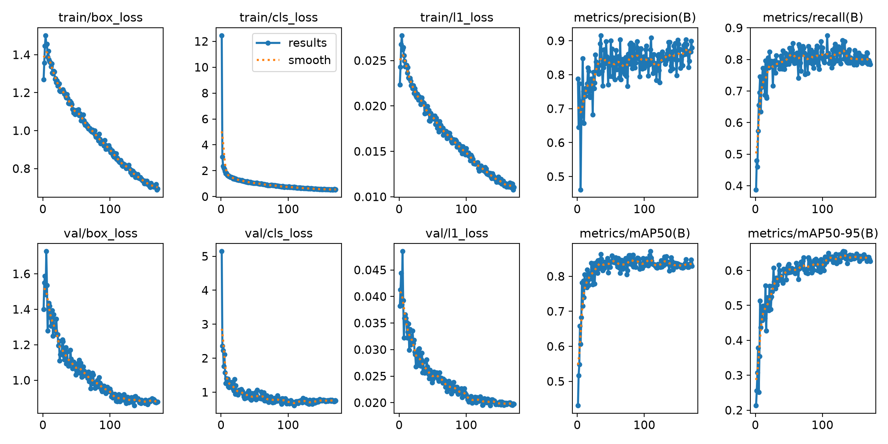

### 1.3 Curva precisión-exhaustividad y F1 vs confianza

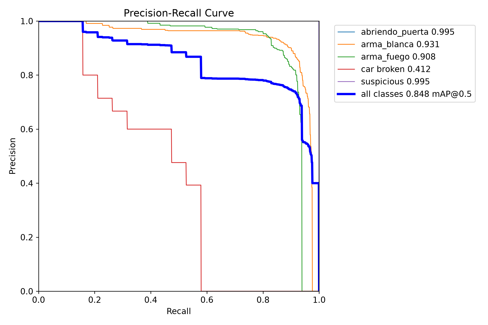

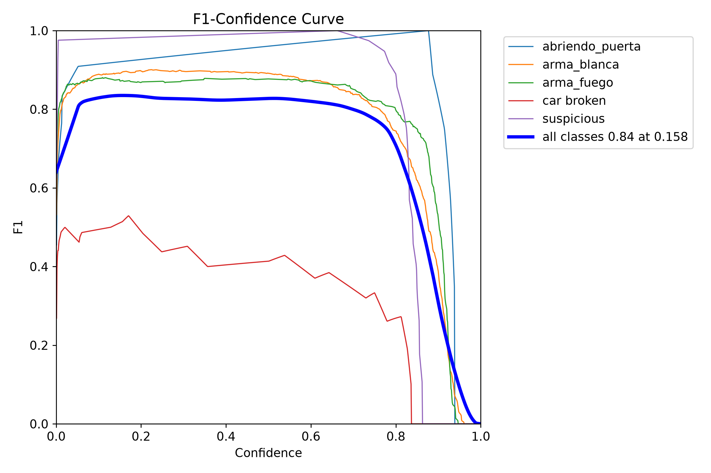

El umbral óptimo global (F1 máximo) es `conf = 0,170`, pero para despliegue se recomienda
**`conf = 0,25`**: conserva F1 = 0,825 con exhaustividad de 0,820 y es un valor estándar
defendible. En videovigilancia **omitir un evento es más costoso que una falsa alarma**
verificable por un operador.

### 1.4 Matriz de confusión normalizada

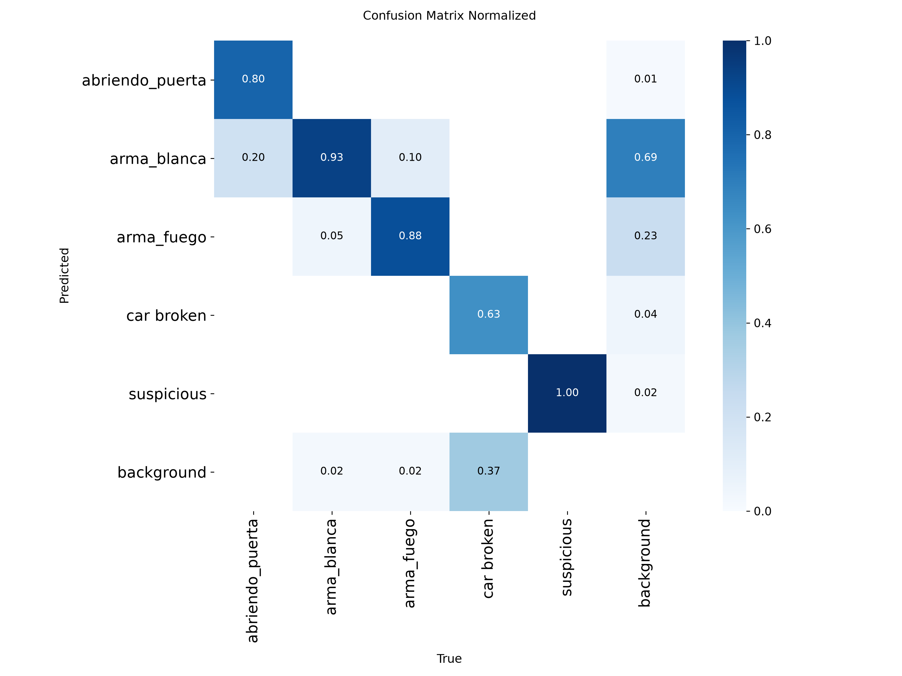

El **error dominante es la omisión, no la confusión**: los falsos negativos representan el
10,9 % en validación y 15,3 % en prueba, cuatro veces más que la confusión entre clases
(2,6 % y 4,6 %). La única pareja de clases realmente confundida es
`arma_blanca` ↔ `arma_fuego`, coherente por tratarse de objetos pequeños, alargados y
sostenidos en mano.

### 1.5 Rendimiento por clase (prueba)

| Clase | Instancias | P | R | F1 | mAP@0.50 | mAP@0.50:0.95 |
|---|---:|---:|---:|---:|---:|---:|
| `abriendo_puerta` | 3 | 0,836 | 1,000 | 0,911 | 0,995 | 0,784 |
| `arma_blanca` | 91 | 0,892 | 0,636 | 0,743 | 0,845 | 0,634 |
| `arma_fuego` | 146 | 0,923 | 0,817 | 0,867 | 0,892 | 0,726 |
| `car broken` | 12 | 0,978 | 0,583 | 0,731 | 0,702 | 0,346 |
| `suspicious` | 10 | 0,969 | 1,000 | 0,984 | 0,995 | 0,716 |
| **Promedio** | **262** | **0,920** | **0,807** | **0,860** | **0,886** | **0,641** |

> Las clases críticas del estudio (`arma_blanca` y `arma_fuego`) obtienen F1 de 0,891 y
> 0,873 en validación. `car broken` es el cuello de botella (mAP@0.50 = 0,450 en validación)
> por escasez de muestras. Las métricas de `abriendo_puerta` y `suspicious` deben leerse
> siempre junto al número de instancias: son indicativas, no concluyentes.

### 1.6 Distribución del dataset

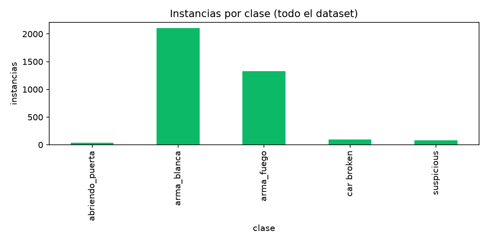

| Partición | Imágenes | % | Instancias | Sin objeto (*background*) |
|---|---:|---:|---:|---:|
| Entrenamiento | 2 057 | 72,8 % | 2 532 | 214 |
| Validación | 571 | 20,2 % | 858 | 48 |
| Prueba | 197 | 7,0 % | 262 | 0 |
| **Total** | **2 825** | **100 %** | **3 652** | **262** |

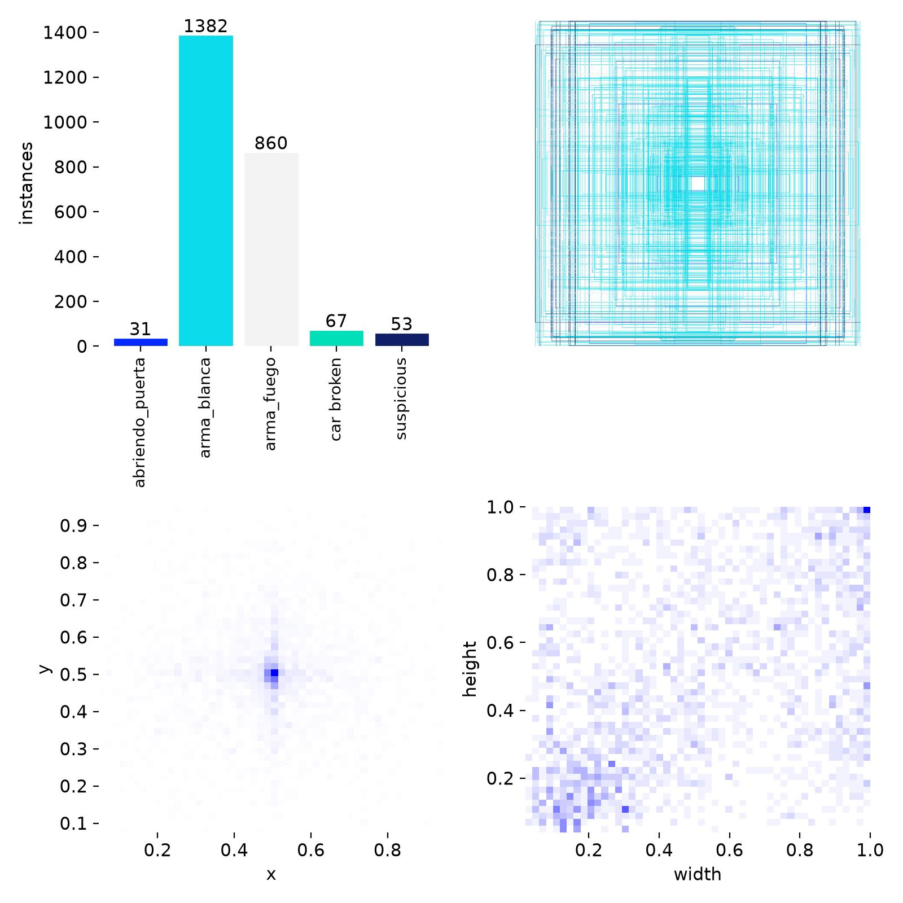

**Desbalance severo:** las dos clases de armas concentran el 94,0 % de las instancias; la
relación entre la clase mayoritaria (`arma_blanca`, 2 107) y la minoritaria
(`abriendo_puerta`, 39) es de **54:1**. Esto condiciona la lectura de las métricas por clase.

### 1.7 Verificación cualitativa

Anotaciones reales frente a predicciones del modelo sobre el mismo lote de la partición de prueba:

| Anotaciones reales | Predicciones |
|---|---|
| 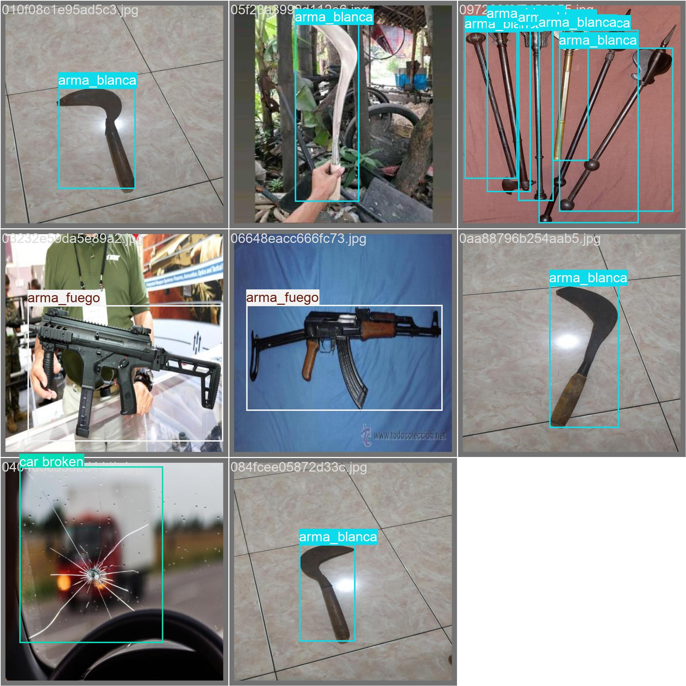 | 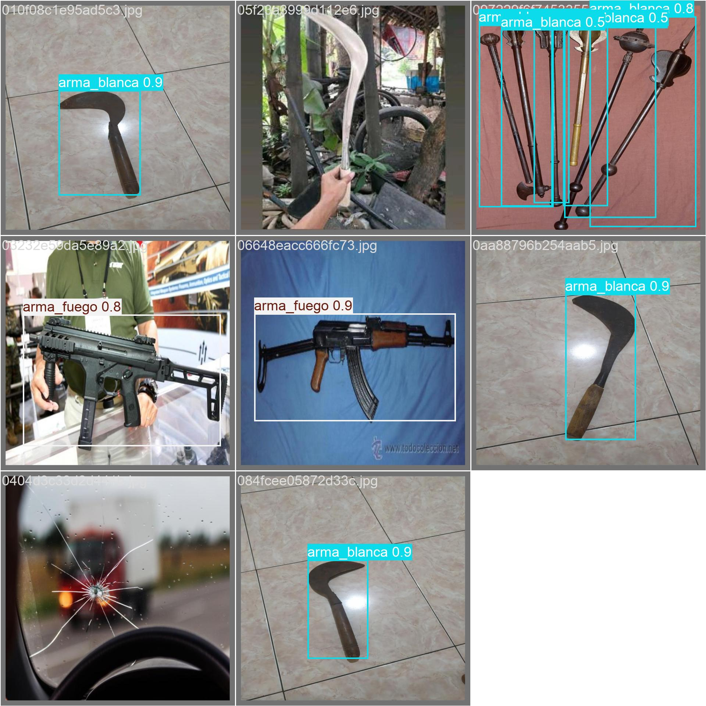 |

Inferencia individual sobre una imagen de prueba:

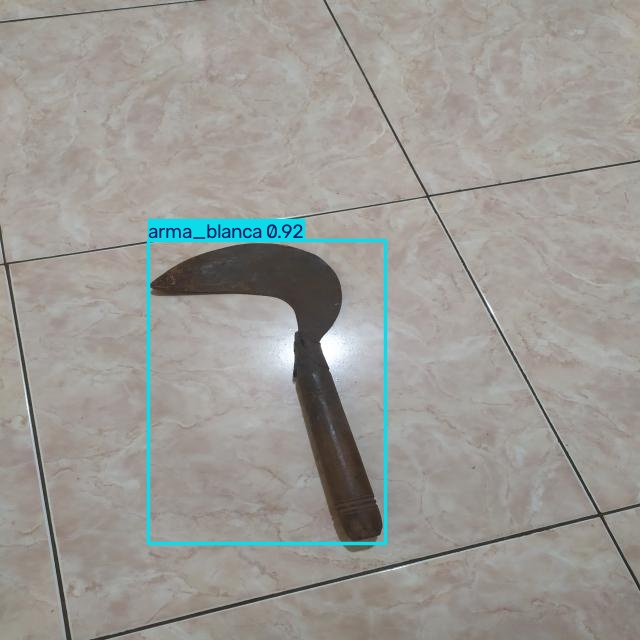

### 1.8 Velocidad de inferencia

| Dispositivo | Pre (ms) | Inferencia (ms) | Post (ms) | Total (ms) | FPS |
|---|---:|---:|---:|---:|---:|
| CPU i7-14650HX (FP32) | 2,03 | 37,29 | 0,51 | **39,82** | **25,1** |
| CPU — por lotes (*batch* 8) | 0,50 | 23,20 | 0,60 | **24,30** | **41,2** |

Viable en tiempo real **incluso sin GPU**. Como la ESP32-CAM opera entre 10 y 15 FPS a
resolución VGA, el modelo no es el cuello de botella del sistema.

> ⚠️ Estas cifras son de **CPU en FP32**. El entrenamiento se realizó en GPU (AMP FP16), pero
> el entorno de medición tenía PyTorch solo para CPU, por lo que **la latencia en GPU quedó
> sin medir** (referencia esperada para YOLO26n en esta gama: 2–5 ms por imagen en FP16).

### 1.9 Hiperparámetros

| Grupo | Parámetro | Valor |
|---|---|---|
| Datos | `imgsz` / `cache` / `batch` | 640 · `ram` · 0,75 (autobatch, 75 % de VRAM) |
| Optimización | `optimizer` / `lr0` / `lrf` | `auto` (SGD) · 0,01 · 0,01 |
| | `cos_lr` / `momentum` / `weight_decay` | `True` · 0,937 · 0,0005 |
| | `warmup_epochs` | 3 |
| Pérdidas | `box` / `cls` / `dfl` | 7,5 · 0,5 · 1,5 |
| Aumentación | `mosaic` (cierre últimas 15 épocas) | 1,0 |
| | `fliplr` / `scale` / `translate` / `erasing` | 0,5 · 0,5 · 0,1 · 0,4 |
| | `hsv_h/s/v` / `auto_augment` | 0,015 / 0,7 / 0,4 · `randaugment` |
| Control | `epochs` / `patience` / `seed` / `amp` | 200 · 40 · 42 · `True` |

**Reproducir:**

```bash
yolo detect train \
  model=weights/yolo26n.pt \
  data=dataset/data_ucsm.yaml \
  epochs=200 patience=40 imgsz=640 batch=0.75 \
  device=0 workers=8 cache=ram amp=True \
  cos_lr=True close_mosaic=15 seed=42 \
  project=runs name=ucsm_yolo26n plots=True
```

📄 **Informe completo (metodología, matrices de confusión, calibración de umbral, limitaciones
y recomendaciones): [`docs/RESULTADOS_TESIS.md`](docs/RESULTADOS_TESIS.md)**

---

## 2. Entrenamiento exploratorio — `yolo_sv` (22 clases)

Primer entrenamiento, sobre el dataset agregado `sv_ucsm` v1 (14 449 imágenes: 11 353 train /
2 113 valid / 983 test). Reunía 22 clases procedentes de varias fuentes heterogéneas, con
etiquetas **duplicadas y solapadas** (`Car`/`car`, `Person`/`person`, `theft`/`theft-detection`,
`Vandalism`/`destroying`, `broken_glass`/`glass shatter`).

**100 épocas en 2,88 h** · YOLO26n · `batch=16`, `imgsz=640`, `patience=20`, `seed=0`.

| Métrica (validación, época 99) | Valor |
|---|---:|
| Precisión (P) | 0,760 |
| Exhaustividad (R) | 0,791 |
| mAP@0.50 | 0,751 |
| mAP@0.50:0.95 | 0,573 |

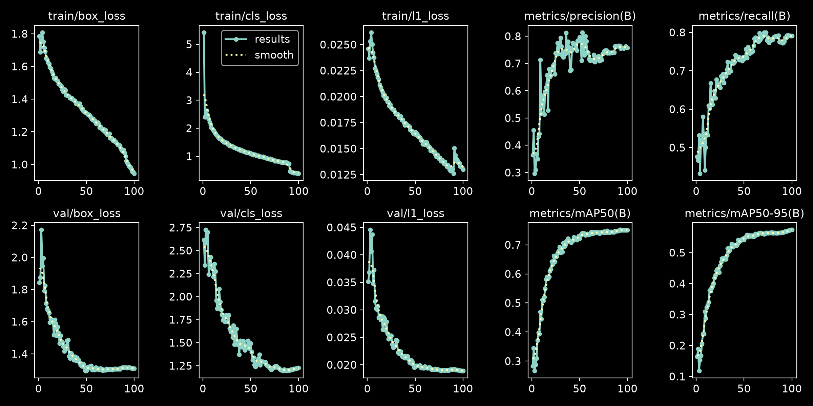

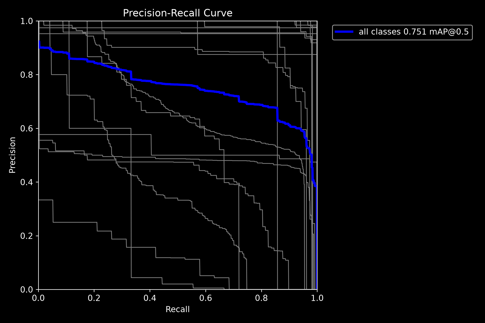

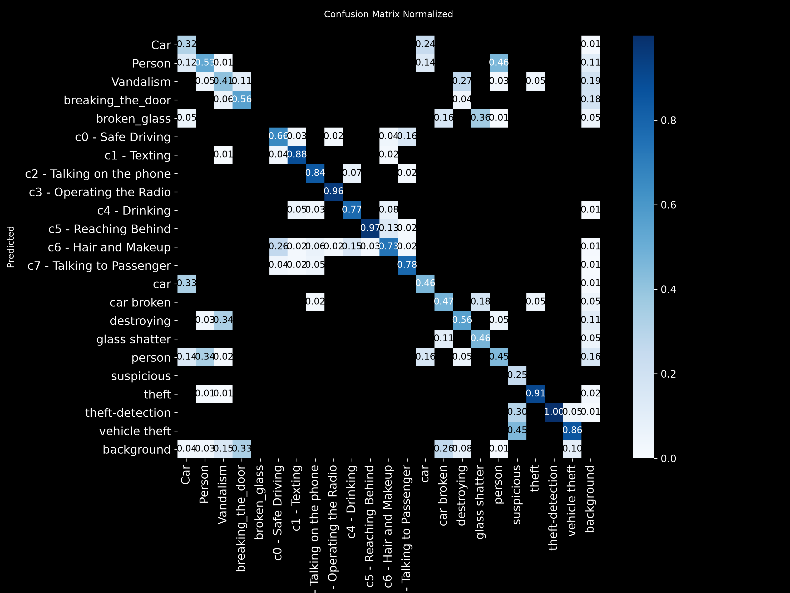

**Diagnóstico.** Las métricas globales están infladas por las 8 clases de distracción al
conducir (`c0`–`c7`, mAP@0.50 entre 0,954 y 0,995: imágenes de cabina muy homogéneas y
fáciles), mientras las clases realmente útiles para videovigilancia se hunden:
`car broken` 0,095 · `destroying` 0,363 · `person` 0,446 · `Vandalism` 0,495.
La duplicidad de etiquetas provoca que el modelo reparta la misma evidencia entre dos
clases rivales. **Esta es la razón por la que el dataset se rediseñó y consolidó en las
5 clases del modelo final.**

Métricas completas por clase: [`docs/sv_22clases/metricas_por_clase.csv`](docs/sv_22clases/metricas_por_clase.csv)

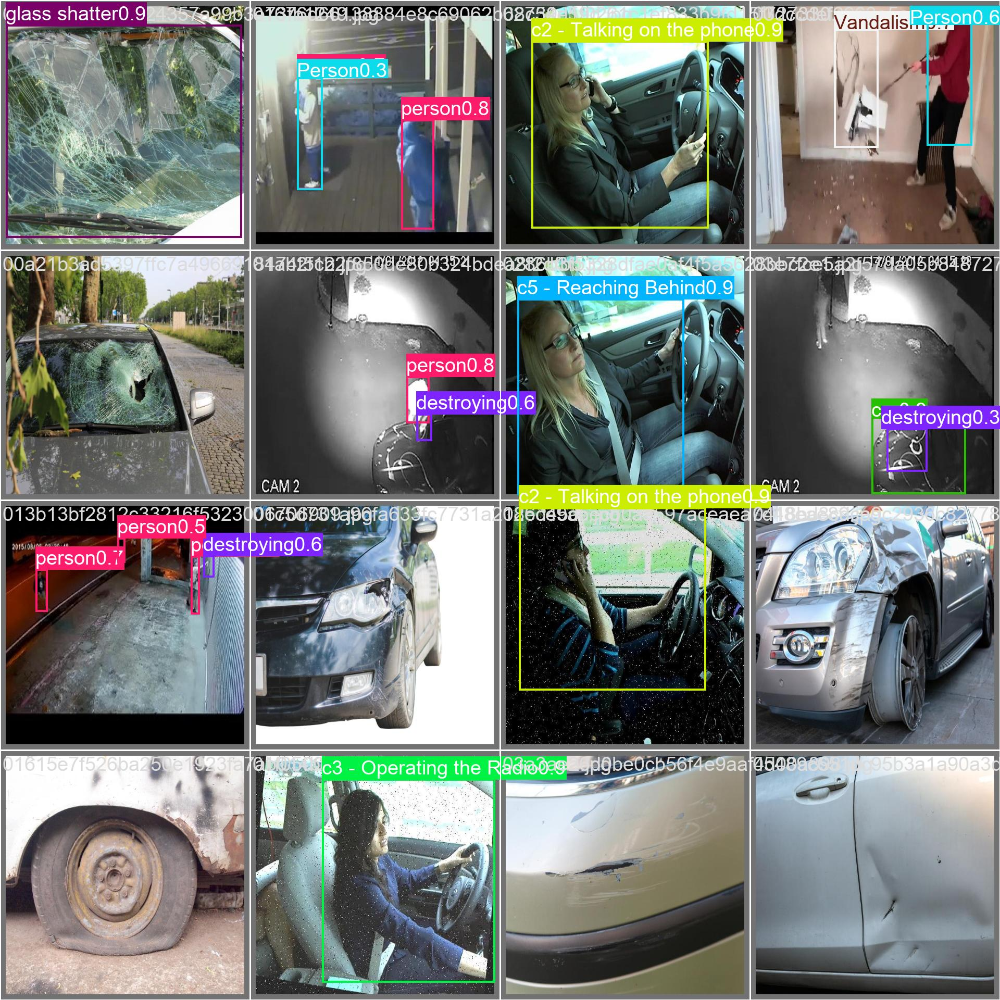

---

## 3. Entrenamiento exploratorio — `weapon_yolo26n` (30 clases)

Entrenamiento sobre el dataset público `weapon-detection-revmd` v1 (3 280 imágenes:
2 584 train / 509 valid / 187 test) con un taxonomía muy fina de armas: `handgun`, `rifle`,
`knife`, `katana`, `sword`, `axe`, `shotgun`, `smg`, `sniper rifle`, `rocket launcher`, etc.

**65 épocas en 0,46 h** (parada temprana, `patience=20`) · YOLO26n · `batch=16`, `imgsz=640`,
`seed=42`, `deterministic=True`. Mejor época: **45**.

| Métrica (validación, época 45) | Valor |
|---|---:|
| Precisión (P) | 0,605 |
| Exhaustividad (R) | 0,584 |
| mAP@0.50 | 0,627 |
| mAP@0.50:0.95 | 0,442 |

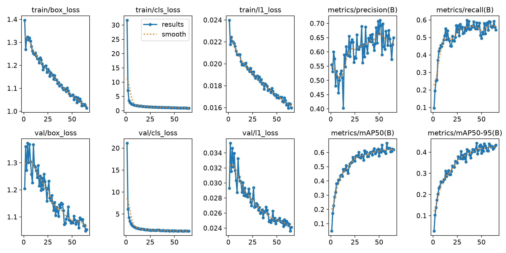

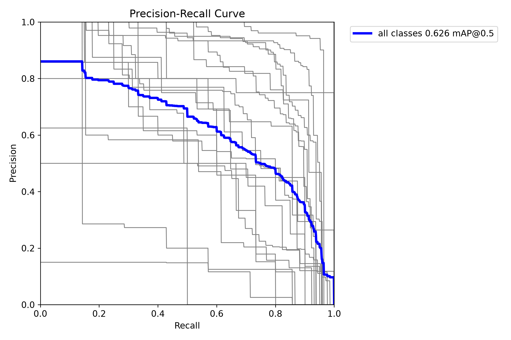

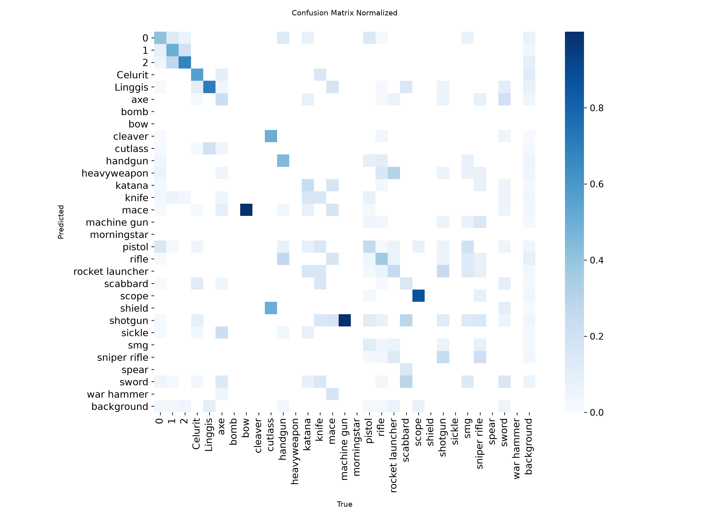

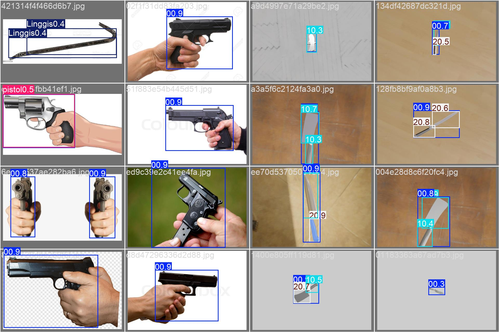

**Diagnóstico.** 30 clases sobre 2 584 imágenes de entrenamiento (≈ 86 imágenes por clase)
es insuficiente, y además el dataset arrastra clases ruidosas (`'0'`, `'1'`, `'2'`) y
distinciones que ni un humano resuelve con fiabilidad a baja resolución (`pistol` vs
`handgun`, `smg` vs `machine gun`, `katana` vs `sword`). **Conclusión que se trasladó al
modelo final: agrupar todo en dos categorías operativas —`arma_blanca` y `arma_fuego`—**,
que es justamente lo que elevó el mAP@0.50 de 0,627 a 0,845–0,892.

---

## 4. Estructura del repositorio

Se versionan únicamente **cuadernos, scripts y gráficas de resultados**. Los datasets, los
pesos (`.pt`, `.onnx`) y las salidas crudas de Ultralytics **no se incluyen** por su tamaño.

```
TRAIN_YOLO26/
├── TRAIN_FINAL_UCSM_YOLO26/
│   └── entrenamiento_yolo26_ucsm.ipynb   # ← cuaderno del modelo final (31 celdas)
├── MIGUEL_TRAIN/
│   ├── entrenar_yolo26_armas.ipynb       # entrenamiento de armas (30 clases)
│   ├── miguel_yolo26_armas.ipynb
│   └── probar_modelo.py                  # inferencia con el modelo entrenado
├── entrenamiento_yolo_sv.ipynb           # entrenamiento exploratorio (22 clases)
├── pruebas.py                            # pruebas de inferencia
├── ds/data.yaml                          # configuración del dataset de 22 clases
├── docs/
│   ├── RESULTADOS_TESIS.md               # informe completo del modelo final
│   ├── final_ucsm/                       # gráficas y CSV de métricas (5 clases)
│   ├── sv_22clases/                      # gráficas y CSV de métricas (22 clases)
│   └── armas/                            # gráficas de métricas (30 clases)
└── requirements.txt
```

### Flujo del cuaderno del modelo final

1. Configuración de rutas e hiperparámetros
2. Instalación de PyTorch **CUDA 12.8** (obligatorio para la RTX serie 50 / Blackwell)
3. Verificación de la GPU (*compute capability*, `sm_120`, prueba FP16)
4. Descarga del dataset desde Roboflow (con nombres de archivo acortados para el límite de 260 caracteres de Windows)
5. Corrección de `data.yaml` a rutas absolutas y análisis exploratorio del dataset
6. Entrenamiento (AMP, autobatch, *cosine LR*, parada temprana, cierre de mosaico)
7. Evaluación en validación y prueba — métricas globales y por clase
8. Medición de velocidad de inferencia (GPU FP16 y CPU)
9. *(Opcional)* Comparación YOLO26n vs YOLO26s
10. Exportación a ONNX / TensorRT y copia al proyecto Django
11. Prueba visual y gráficas

---

## 5. Instalación

```bash
git clone https://github.com/papita23/TRAIN_YOLO26.git
cd TRAIN_YOLO26
python -m venv .venv
.venv\Scripts\activate
pip install -r requirements.txt
```

**GPU NVIDIA serie 50 (Blackwell, `sm_120`).** El PyTorch que instala `pip` por defecto
**no** reconoce estas GPU. Hay que instalar la build `cu128` y tener driver NVIDIA ≥ 570:

```bash
pip uninstall -y torch torchvision torchaudio
pip install torch torchvision --index-url https://download.pytorch.org/whl/cu128
```

Verificación:

```python
import torch
print(torch.cuda.is_available(), torch.cuda.get_device_name(0))
print(torch.cuda.get_arch_list())   # debe incluir sm_120
```

---

## 6. Uso

1. Descarga el dataset desde Roboflow (el cuaderno lo hace; la API key se lee de la variable
   de entorno `ROBOFLOW_API_KEY`, nunca se escribe en el cuaderno).
2. Ejecuta las celdas del cuaderno en orden.
3. Prueba el modelo entrenado:

```bash
python MIGUEL_TRAIN/probar_modelo.py
```

### Despliegue (servidor Django)

```env
YOLO_MODELO=modelos_ia/yolo26_ucsm_best.pt
YOLO_NOMBRE=yolo26n
YOLO_CLASES=abriendo_puerta,arma_blanca,arma_fuego,car broken,suspicious
YOLO_CONF=0.25
YOLO_IOU=0.70
YOLO_IMGSZ=640
```

---

## 7. Limitaciones conocidas

1. **Desbalance de clases 54:1** en el dataset final; las métricas globales están dominadas
   por las dos clases de armas.
2. **Tres clases sin representatividad estadística:** `abriendo_puerta` (5 instancias en
   validación), `car broken` (19) y `suspicious` (20). Sus métricas son indicativas.
3. **Partición de prueba pequeña** (197 imágenes / 262 instancias).
4. **51 anotaciones duplicadas** en validación, depuradas automáticamente por Ultralytics.
5. **Latencia en GPU sin medir** y exportación a TensorRT pendiente (`tensorrt` no instalado).
6. **Sin estudio de ablación:** no se entrenó YOLO26s para contrastar precisión/velocidad.
7. **Evaluación sobre imágenes estáticas**, no sobre vídeo continuo con seguimiento temporal,
   que es la condición real de operación del sistema.

Prioridades de mejora: ampliar `car broken` a ≥ 300 instancias, `abriendo_puerta` y
`suspicious` a ≥ 200 cada una, y la partición de prueba a ≥ 500 imágenes.

---

## 8. Licencia y créditos

- **Modelos:** YOLO26 ([Ultralytics](https://github.com/ultralytics/ultralytics))
- **Datasets:** alojados en [Roboflow Universe](https://universe.roboflow.com/darwin-turpo-s-workspace) · licencia CC BY 4.0
- **Autor:** Miguel — Universidad Católica de Santa María (UCSM), Arequipa, Perú
- Proyecto de tesis 2026 — Sistema de videovigilancia inteligente con ESP32-CAM
