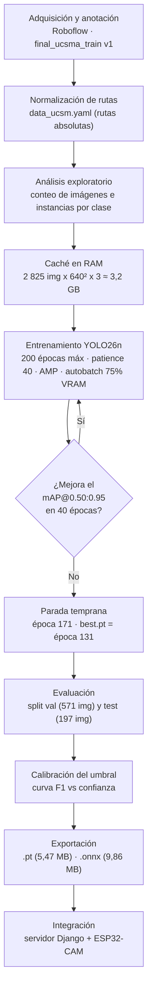
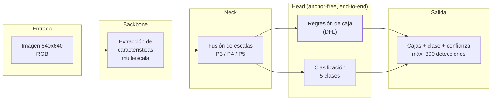
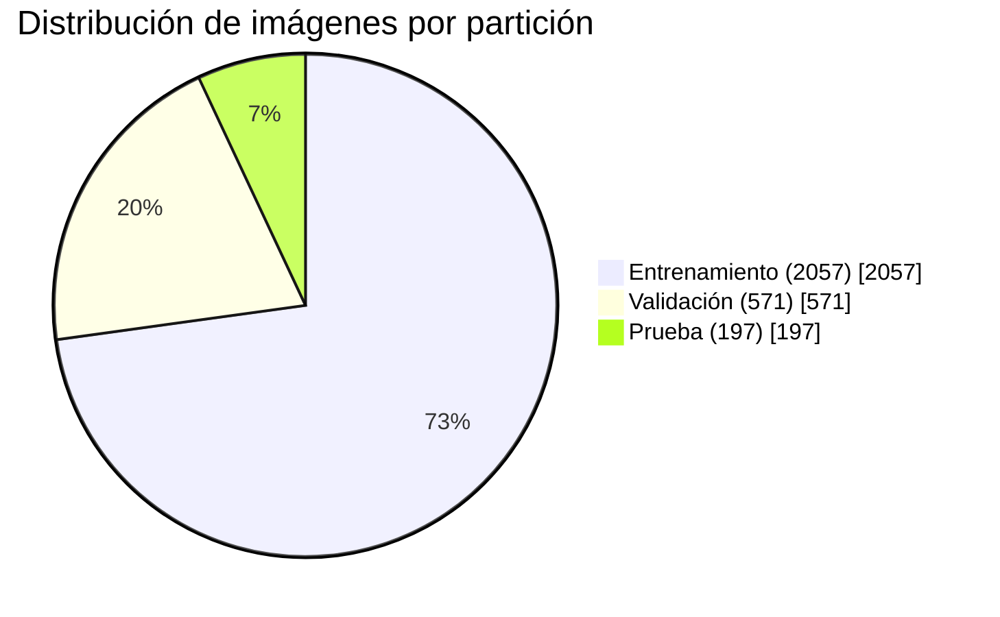
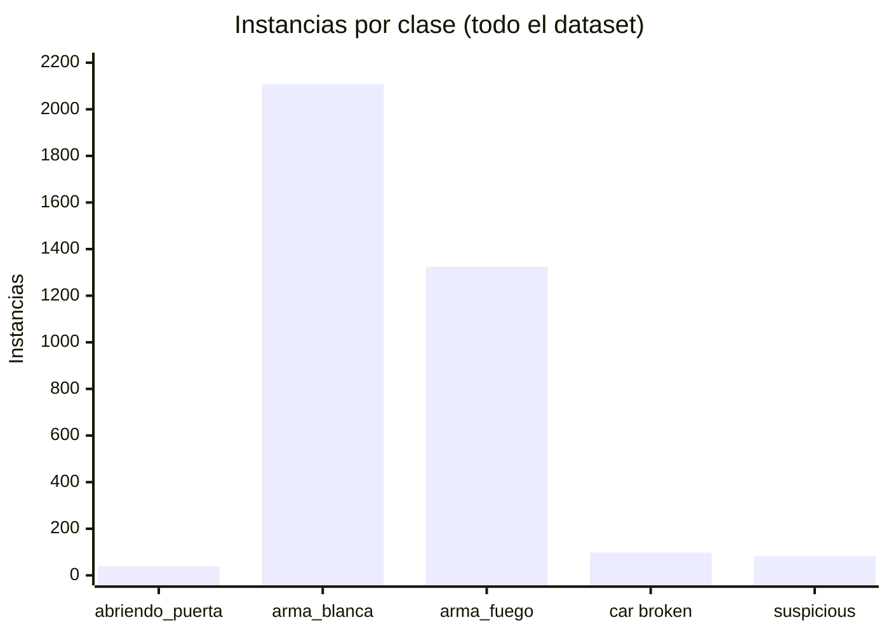
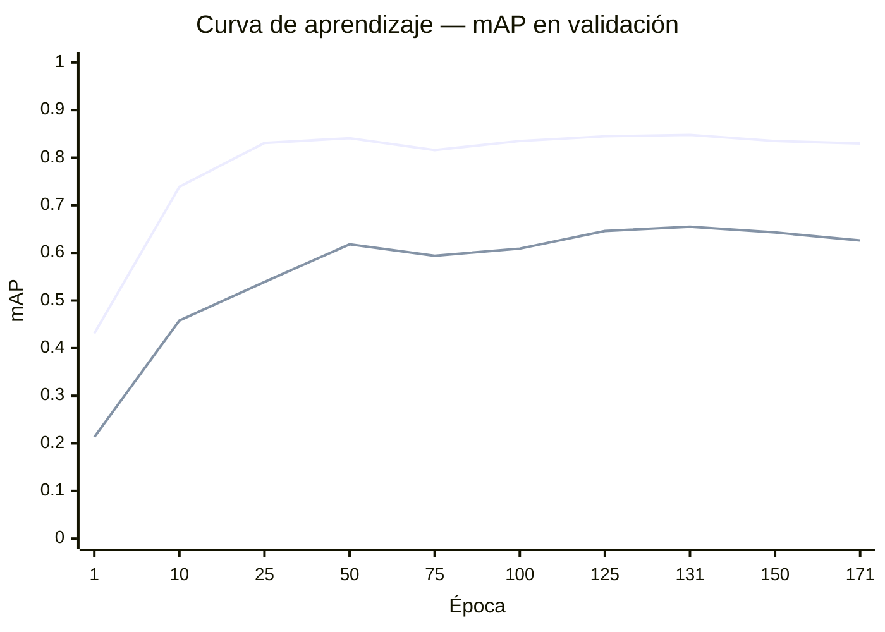
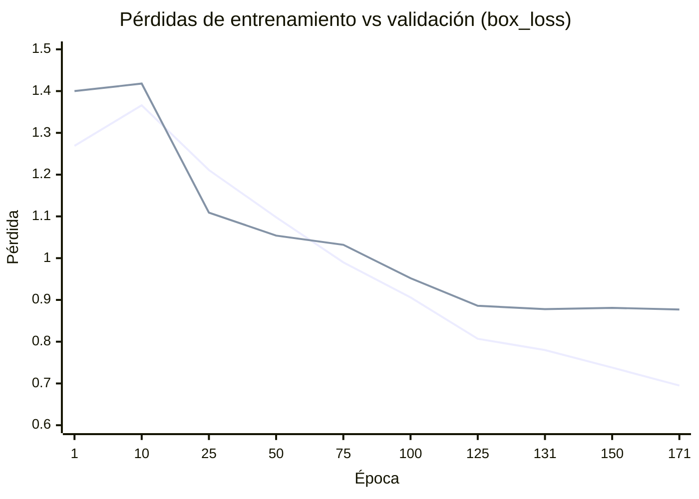
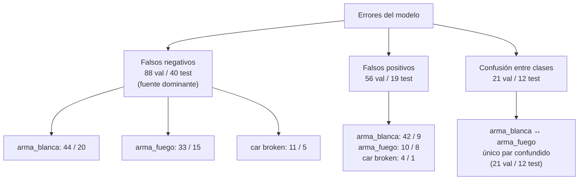
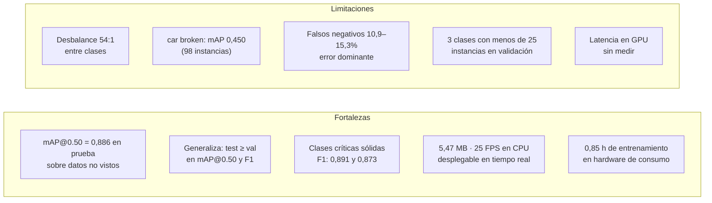

# Resultados del entrenamiento y evaluación del modelo YOLO26n para detección de eventos de riesgo

**Dataset:** `final_ucsma_train` v1 (Roboflow) · **Modelo:** YOLO26n · **Experimento:** `ucsm_yolo26n`
**Fecha de entrenamiento:** 16 de octubre de 2026 · **Fecha de evaluación:** 17 de octubre de 2026

---

## 1. Resumen ejecutivo

Se entrenó un detector de objetos **YOLO26n** (2,54 M de parámetros, 5,4 GFLOPs) sobre un conjunto propio de
**2 825 imágenes** y **3 652 instancias** distribuidas en **5 clases** de eventos de riesgo en vía pública.
El entrenamiento convergió en **171 épocas (0,85 h)** por parada temprana y el mejor modelo se obtuvo en la
**época 131**.

| Indicador | Validación | Prueba (*test*) |
|---|---:|---:|
| Precisión (P) | **0,827** | **0,920** |
| Exhaustividad (R) | **0,848** | **0,807** |
| F1 | **0,837** | **0,860** |
| mAP@0.50 | **0,860** | **0,886** |
| mAP@0.50:0.95 | **0,679** | **0,641** |

> **Lectura:** el modelo alcanza un mAP@0.50 de **0,886 en el conjunto de prueba** (datos nunca vistos),
> con un peso de solo **5,47 MB**, lo que lo hace apto para despliegue en tiempo real.
> Las clases críticas del estudio —`arma_blanca` y `arma_fuego`— obtienen mAP@0.50 de **0,845** y **0,892**
> respectivamente. La clase `car broken` es el punto débil (mAP@0.50 = 0,702) por escasez de muestras.

---

## 2. Materiales y métodos

### 2.1 Entorno experimental

| Componente | Especificación |
|---|---|
| GPU | NVIDIA RTX 5060 Laptop, 8 GB VRAM (Blackwell, *compute capability* 12.0) |
| CPU | Intel Core i7-14650HX |
| RAM | 32 GB |
| Sistema operativo | Windows 11 |
| Framework | Ultralytics 8.4.33 · PyTorch (CUDA 12.8) |
| Python | 3.14 |
| Precisión de cómputo | AMP (FP16 mixto) |

### 2.2 Flujo metodológico



### 2.3 Arquitectura y canal de inferencia



| Propiedad del modelo | Valor |
|---|---|
| Variante | YOLO26n (*nano*) |
| Capas | 261 (147 tras fusión BN) |
| Parámetros | 2 535 830 (2 526 046 fusionados) |
| Complejidad | 5,4 GFLOPs @ 640×640 |
| Pesos iniciales | `yolo26n.pt` preentrenado en COCO (*transfer learning*) |
| Tamaño `.pt` | 5,47 MB |
| Tamaño `.onnx` | 9,86 MB |

---

## 3. Descripción del conjunto de datos

### 3.1 Partición



**Tabla 1.** Composición del conjunto de datos

| Partición | Imágenes | % | Instancias | Imágenes sin objeto (*background*) |
|---|---:|---:|---:|---:|
| Entrenamiento | 2 057 | 72,8 % | 2 532 | 214 |
| Validación | 571 | 20,2 % | 858 | 48 |
| Prueba | 197 | 7,0 % | 262 | 0 |
| **Total** | **2 825** | **100 %** | **3 652** | **262** |

> *Nota metodológica:* durante la evaluación Ultralytics depura **51 anotaciones duplicadas** en la partición
> de validación, por lo que las métricas de `val` se calculan sobre **807 instancias** efectivas.
> No se detectaron imágenes sin archivo de anotación en ninguna partición.

### 3.2 Distribución por clase

**Tabla 2.** Instancias por clase y partición

| # | Clase | Entrenamiento | Validación | Prueba | Total | % del total |
|---:|---|---:|---:|---:|---:|---:|
| 0 | `abriendo_puerta` | 31 | 5 | 3 | 39 | 1,1 % |
| 1 | `arma_blanca` | 1 477 | 539 | 91 | 2 107 | 57,7 % |
| 2 | `arma_fuego` | 904 | 275 | 146 | 1 325 | 36,3 % |
| 3 | `car broken` | 67 | 19 | 12 | 98 | 2,7 % |
| 4 | `suspicious` | 53 | 20 | 10 | 83 | 2,3 % |
| | **Total** | **2 532** | **858** | **262** | **3 652** | **100 %** |



> **Hallazgo 1 — Desbalance severo.** Las dos clases de armas concentran el **94,0 %** de las instancias.
> La relación entre la clase mayoritaria (`arma_blanca`, 2 107) y la minoritaria (`abriendo_puerta`, 39) es de
> **54:1**. Este desbalance condiciona directamente la interpretación de las métricas por clase (§5.3).

*Figura asociada:* `dataset_clases.png` · `labels.jpg` (distribución espacial y de tamaños de las cajas).

---

## 4. Configuración del entrenamiento

**Tabla 3.** Hiperparámetros (fuente: `args.yaml`)

| Grupo | Parámetro | Valor | Justificación |
|---|---|---|---|
| **Datos** | `imgsz` | 640 | Igual a la resolución VGA de la ESP32-CAM |
| | `cache` | `ram` | 2 825 img ≈ 3,2 GB; elimina el cuello de botella de E/S |
| | `batch` | 0,75 (autobatch) | Ocupa el 75 % de los 8 GB de VRAM |
| **Optimización** | `optimizer` | `auto` (SGD) | Selección automática de Ultralytics |
| | `lr0` / `lrf` | 0,01 / 0,01 | LR inicial y factor final |
| | `cos_lr` | `True` | Decaimiento cosenoidal: convergencia más estable |
| | `momentum` | 0,937 | Valor por defecto validado en YOLO |
| | `weight_decay` | 0,0005 | Regularización L2 |
| | `warmup_epochs` | 3 | Evita divergencia inicial |
| **Pérdidas** | `box` / `cls` / `dfl` | 7,5 / 0,5 / 1,5 | Ponderación por defecto |
| **Aumentación** | `mosaic` | 1,0 (cerrado últimas 15 épocas) | Diversidad de contexto; el cierre afina la geometría |
| | `fliplr` | 0,5 | Simetría horizontal |
| | `hsv_h/s/v` | 0,015 / 0,7 / 0,4 | Robustez a iluminación y color |
| | `scale` / `translate` | 0,5 / 0,1 | Invarianza a escala y posición |
| | `erasing` | 0,4 | Robustez a oclusiones parciales |
| | `auto_augment` | `randaugment` | Aumentación adicional en clasificación |
| **Control** | `epochs` / `patience` | 200 / 40 | Parada temprana |
| | `seed` | 42 | Reproducibilidad |
| | `amp` | `True` | FP16 mixto: ~2× velocidad, menos VRAM |

**Costo computacional**

| Métrica | Valor |
|---|---|
| Épocas ejecutadas | 171 de 200 (parada temprana) |
| Mejor época (`best.pt`) | **131** |
| Tiempo total | **0,85 h (3 058,6 s)** |
| Tiempo medio por época | **17,9 s** |

---

## 5. Resultados

### 5.1 Evolución del entrenamiento

**Tabla 4.** Métricas en hitos del entrenamiento (fuente: `results.csv`)

| Época | box_loss (tr) | cls_loss (tr) | box_loss (val) | cls_loss (val) | P | R | mAP@0.50 | mAP@0.50:0.95 |
|---:|---:|---:|---:|---:|---:|---:|---:|---:|
| 1 | 1,269 | 12,457 | 1,400 | 5,145 | 0,788 | 0,387 | 0,431 | 0,213 |
| 10 | 1,366 | 1,607 | 1,418 | 1,394 | 0,657 | 0,743 | 0,739 | 0,458 |
| 25 | 1,211 | 1,306 | 1,109 | 0,922 | 0,759 | 0,792 | 0,831 | 0,539 |
| 50 | 1,098 | 1,029 | 1,054 | 0,906 | 0,900 | 0,786 | 0,841 | 0,618 |
| 75 | 0,990 | 0,895 | 1,032 | 0,853 | 0,767 | 0,815 | 0,816 | 0,594 |
| 100 | 0,906 | 0,767 | 0,952 | 0,692 | 0,820 | 0,837 | 0,835 | 0,609 |
| 125 | 0,807 | 0,645 | 0,886 | 0,730 | 0,854 | 0,823 | 0,845 | 0,646 |
| **131** | **0,780** | **0,628** | **0,878** | **0,653** | **0,831** | **0,848** | **0,848** | **0,655** |
| 150 | 0,738 | 0,549 | 0,881 | 0,756 | 0,902 | 0,804 | 0,835 | 0,643 |
| 171 | 0,695 | 0,541 | 0,877 | 0,748 | 0,879 | 0,784 | 0,830 | 0,626 |



*Serie superior: mAP@0.50 · Serie inferior: mAP@0.50:0.95*



*Serie descendente continua: entrenamiento · Serie que se estabiliza: validación*

> **Hallazgo 2 — Convergencia y sobreajuste controlado.** La pérdida de entrenamiento desciende de forma
> monótona (1,269 → 0,695), mientras la de validación se **estanca en ≈ 0,878 a partir de la época 125**.
> Esa divergencia marca el inicio del sobreajuste y es exactamente lo que la parada temprana captura:
> `best.pt` corresponde a la época 131, donde el mAP@0.50:0.95 es máximo (0,655) antes de degradarse
> (0,626 en la época 171). **La parada temprana evitó una pérdida de 2,9 puntos de mAP@0.50:0.95.**

*Figura asociada:* `results.png` (12 subgráficas: pérdidas y métricas por época).

### 5.2 Métricas globales del modelo final

**Tabla 5.** Rendimiento global de `best.pt` (época 131)

| Métrica | Validación (571 img / 807 inst.) | Prueba (197 img / 262 inst.) | Δ |
|---|---:|---:|---:|
| Precisión (P) | 0,8268 | 0,9195 | +0,093 |
| Exhaustividad (R) | 0,8483 | 0,8073 | −0,041 |
| F1 | 0,8374 | 0,8598 | +0,022 |
| mAP@0.50 | 0,8597 | 0,8859 | +0,026 |
| mAP@0.50:0.95 | 0,6787 | 0,6411 | −0,038 |

> **Hallazgo 3 — Buena capacidad de generalización.** El mAP@0.50 en prueba (0,886) **supera** el de
> validación (0,860), y el F1 también mejora (0,860 vs 0,837). Esto descarta sobreajuste a la partición de
> validación. La caída de 3,8 puntos en mAP@0.50:0.95 indica que las cajas predichas en prueba son algo
> menos ajustadas geométricamente, atribuible a la mayor proporción de `car broken` (4,6 % en prueba
> frente a 2,4 % en validación), la clase con peor localización.

### 5.3 Métricas por clase

**Tabla 6.** Rendimiento por clase — partición de **validación**

| Clase | Instancias | P | R | F1 | mAP@0.50 | mAP@0.50:0.95 |
|---|---:|---:|---:|---:|---:|---:|
| `abriendo_puerta` | 5 | 0,853 | 1,000 | 0,921 | 0,995 | 0,808 |
| `arma_blanca` | 488 | 0,869 | 0,914 | 0,891 | 0,935 | 0,749 |
| `arma_fuego` | 275 | 0,893 | 0,853 | 0,873 | 0,924 | 0,736 |
| `car broken` | 19 | 0,555 | 0,474 | 0,511 | 0,450 | 0,310 |
| `suspicious` | 20 | 0,963 | 1,000 | 0,981 | 0,995 | 0,790 |
| **Promedio** | **807** | **0,827** | **0,848** | **0,837** | **0,860** | **0,679** |

**Tabla 7.** Rendimiento por clase — partición de **prueba**

| Clase | Instancias | P | R | F1 | mAP@0.50 | mAP@0.50:0.95 |
|---|---:|---:|---:|---:|---:|---:|
| `abriendo_puerta` | 3 | 0,836 | 1,000 | 0,911 | 0,995 | 0,784 |
| `arma_blanca` | 91 | 0,892 | 0,636 | 0,743 | 0,845 | 0,634 |
| `arma_fuego` | 146 | 0,923 | 0,817 | 0,867 | 0,892 | 0,726 |
| `car broken` | 12 | 0,978 | 0,583 | 0,731 | 0,702 | 0,346 |
| `suspicious` | 10 | 0,969 | 1,000 | 0,984 | 0,995 | 0,716 |
| **Promedio** | **262** | **0,920** | **0,807** | **0,860** | **0,886** | **0,641** |

```mermaid
xychart-beta
    title "mAP@0.50 por clase (validación vs prueba)"
    x-axis ["abrir_puerta", "arma_blanca", "arma_fuego", "car_broken", "suspicious"]
    y-axis "mAP@0.50" 0 --> 1
    bar [0.995, 0.935, 0.924, 0.450, 0.995]
    bar [0.995, 0.845, 0.892, 0.702, 0.995]
```



*Primera serie: validación · Segunda serie: prueba*

> **Hallazgo 4 — `car broken` es el cuello de botella.** Con solo 98 instancias totales, esta clase obtiene
> el peor desempeño en ambas particiones (mAP@0.50 de 0,450 en validación y 0,702 en prueba) y el peor
> mAP@0.50:0.95 (0,310 / 0,346). Su alta precisión en prueba (0,978) con bajo *recall* (0,583) revela un
> modelo **conservador**: cuando detecta un vehículo dañado casi siempre acierta, pero omite más del 40 %
> de los casos. Es la clase que requiere ampliación prioritaria del conjunto de datos.
>
> **Hallazgo 5 — Las métricas de clases minoritarias no son concluyentes.** `abriendo_puerta` (5 y 3
> instancias) y `suspicious` (20 y 10) alcanzan mAP@0.50 = 0,995, pero ese valor se calcula sobre muestras
> demasiado pequeñas para ser estadísticamente representativo. **Deben reportarse en la tesis siempre
> acompañadas del número de instancias.**
>
> **Hallazgo 6 — Clases críticas con rendimiento sólido.** `arma_blanca` y `arma_fuego`, que concentran el
> 94 % de los datos y constituyen el objetivo central del estudio, obtienen F1 de 0,891 y 0,873 en
> validación. En prueba, `arma_blanca` pierde *recall* (0,636) —detecta 2 de cada 3 armas blancas
> presentes—, mientras `arma_fuego` se mantiene estable (R = 0,817).

*Figuras asociadas:* `BoxPR_curve.png` (curvas precisión-exhaustividad por clase) ·
`BoxF1_curve.png` (F1 frente a confianza) · `val_runs/val/BoxPR_curve.png` · `val_runs/test/BoxPR_curve.png`.

### 5.4 Matrices de confusión

**Tabla 8.** Matriz de confusión — validación (filas = predicción, columnas = verdad)

| Predicho ↓ / Real → | abriendo_puerta | arma_blanca | arma_fuego | car broken | suspicious | *fondo* |
|---|---:|---:|---:|---:|---:|---:|
| `abriendo_puerta` | **5** | 0 | 0 | 0 | 0 | 0 |
| `arma_blanca` | 0 | **433** | 10 | 0 | 0 | 42 |
| `arma_fuego` | 0 | 11 | **232** | 0 | 0 | 10 |
| `car broken` | 0 | 0 | 0 | **8** | 0 | 4 |
| `suspicious` | 0 | 0 | 0 | 0 | **20** | 0 |
| *fondo (no detectado)* | 0 | 44 | 33 | 11 | 0 | — |

**Tabla 9.** Matriz de confusión — prueba

| Predicho ↓ / Real → | abriendo_puerta | arma_blanca | arma_fuego | car broken | suspicious | *fondo* |
|---|---:|---:|---:|---:|---:|---:|
| `abriendo_puerta` | **3** | 0 | 0 | 0 | 0 | 1 |
| `arma_blanca` | 0 | **63** | 4 | 0 | 0 | 9 |
| `arma_fuego` | 0 | 8 | **127** | 0 | 0 | 8 |
| `car broken` | 0 | 0 | 0 | **7** | 0 | 1 |
| `suspicious` | 0 | 0 | 0 | 0 | **10** | 0 |
| *fondo (no detectado)* | 0 | 20 | 15 | 5 | 0 | — |

**Tabla 10.** Descomposición de errores

| Tipo de error | Validación | Prueba |
|---|---:|---:|
| Aciertos (diagonal) | 698 / 807 (86,5 %) | 210 / 262 (80,2 %) |
| Confusión entre clases | 21 (2,6 %) | 12 (4,6 %) |
| No detectados (*falsos negativos*) | 88 (10,9 %) | 40 (15,3 %) |
| Detecciones espurias (*falsos positivos* sobre fondo) | 56 | 19 |



> **Hallazgo 7 — El error dominante es la omisión, no la confusión.** Los falsos negativos representan el
> **10,9 % en validación y 15,3 % en prueba**, cuatro veces más que la confusión entre clases (2,6 % y
> 4,6 %). El modelo **discrimina bien las categorías pero falla en detectar la presencia** del objeto.
> Para un sistema de videovigilancia esto es relevante: un evento omitido es más grave que uno mal
> clasificado, lo que justifica operar con un umbral de confianza bajo (§5.5).
>
> **Hallazgo 8 — La única confusión relevante es `arma_blanca` ↔ `arma_fuego`.** Es coherente: ambas son
> objetos pequeños, alargados y sostenidos en mano, frecuentemente con oclusión parcial y baja resolución.
> Ninguna otra pareja de clases presenta confusión.

*Figuras asociadas:* `confusion_matrix.png` (absoluta) · `confusion_matrix_normalized.png` (normalizada) ·
`val_runs/val/` y `val_runs/test/`.

### 5.5 Calibración del umbral de confianza

Las métricas anteriores se calculan sobre todo el rango de confianza. Para el **despliegue** es necesario
fijar un umbral operativo. Se barrió el rango de 0 a 1 en 1 000 pasos sobre la partición de validación.

**Umbral óptimo global (máximo F1): `conf = 0,170` → F1 = 0,840, P = 0,840, R = 0,846**

**Tabla 11.** Compromiso precisión-exhaustividad según el umbral (validación)

| Umbral | Precisión | Exhaustividad | F1 |
|---:|---:|---:|---:|
| 0,25 | 0,839 | 0,820 | 0,825 |
| 0,30 | 0,853 | 0,816 | 0,829 |
| 0,35 | 0,854 | 0,806 | 0,823 |
| 0,40 | 0,860 | 0,803 | 0,823 |
| 0,45 | 0,869 | 0,800 | 0,825 |
| **0,50** | **0,877** | **0,798** | **0,827** |
| 0,55 | 0,894 | 0,791 | 0,828 |
| 0,60 | 0,894 | 0,777 | 0,819 |
| 0,70 | 0,914 | 0,743 | 0,801 |

**Tabla 12.** Umbral óptimo por clase (validación)

| Clase | Umbral F1 máx. | F1 máx. | Umbral para P ≥ 0,90 | R en ese punto |
|---|---:|---:|---:|---:|
| `abriendo_puerta` | 0,876 | 1,000 | 0,382 | 1,000 |
| `arma_blanca` | 0,224 | 0,901 | 0,229 | 0,900 |
| `arma_fuego` | 0,107 | 0,880 | 0,198 | 0,836 |
| `car broken` | 0,170 | 0,529 | 0,799 | 0,158 |
| `suspicious` | 0,661 | 1,000 | 0,005 | 1,000 |

> **Hallazgo 9 — Recomendación operativa.** Elevar el umbral de 0,25 a 0,70 gana 7,5 puntos de precisión
> pero cuesta 7,7 puntos de exhaustividad: el F1 cae de 0,825 a 0,801. Para un sistema de videovigilancia,
> donde **omitir un evento es más costoso que generar una falsa alarma verificable por un operador**, se
> recomienda **`conf = 0,25`** como valor de despliegue: conserva un F1 de 0,825 con exhaustividad de 0,820,
> mantiene la precisión por encima de 0,80 y es un valor estándar defendible metodológicamente.
> El óptimo matemático (0,170) maximiza el F1 pero es demasiado permisivo para operación continua.
>
> Para las dos clases críticas basta `conf ≈ 0,23` para alcanzar **precisión ≥ 0,90 conservando recall de
> 0,90 (`arma_blanca`) y 0,84 (`arma_fuego`)** — un punto de operación excelente.

### 5.6 Velocidad de inferencia

**Tabla 13.** Latencia y rendimiento (640×640, 60 imágenes de prueba, una por lote)

| Dispositivo | Pre (ms) | Inferencia (ms) | Post (ms) | **Total (ms)** | p95 (ms) | **FPS** |
|---|---:|---:|---:|---:|---:|---:|
| CPU i7-14650HX (FP32) | 2,03 | 37,29 | 0,51 | **39,82** | 44,32 | **25,1** |
| CPU — evaluación por lotes (*batch* 8) | 0,50 | 23,20 | 0,60 | **24,30** | — | **41,2** |

> **Hallazgo 10 — Viable en tiempo real incluso sin GPU.** El modelo alcanza **25 FPS en CPU** procesando
> imagen por imagen y **41 FPS con lotes de 8**. Como la ESP32-CAM opera típicamente entre 10 y 15 FPS a
> resolución VGA, **el modelo no es el cuello de botella del sistema**: existe margen suficiente para
> procesar varias cámaras en paralelo sobre el mismo servidor.

> ⚠️ **Limitación de la medición.** Estas cifras corresponden a **CPU en FP32**. El entrenamiento se realizó
> en la RTX 5060 (`device=0`, AMP FP16), pero el entorno de evaluación disponible tenía PyTorch compilado
> solo para CPU, por lo que **no se pudo medir la latencia en GPU**. Para completar la Tabla 13 con los
> valores de GPU, reinstalar PyTorch `cu128` y ejecutar la celda 20 del cuaderno
> (`entrenamiento_yolo26_ucsm.ipynb`), o bien:
>
> ```python
> from ultralytics import YOLO
> m = YOLO("modelo_final/yolo26_ucsm_best.pt")
> m.val(data="dataset/data_ucsm.yaml", split="test", imgsz=640, device=0, half=True)
> # la línea "Speed:" del log reporta pre / inferencia / post en ms por imagen
> ```
>
> Como referencia, YOLO26n en GPU de esta gama suele ubicarse en **2–5 ms por imagen (200–500 FPS)** en
> FP16, y por debajo de 2 ms con TensorRT. La exportación a TensorRT (`.engine`) quedó pendiente porque
> `tensorrt` no está instalado; el `.onnx` sí se generó correctamente.

### 5.7 Verificación cualitativa

| Archivo | Contenido |
|---|---|
| `val_runs/val/val_batch0_pred.jpg` … `val_batch2_pred.jpg` | Predicciones en validación |
| `val_runs/val/val_batch0_labels.jpg` … `val_batch2_labels.jpg` | Anotaciones reales (comparación visual directa) |
| `val_runs/test/val_batch*_pred.jpg` | Predicciones en la partición de prueba |
| `../modelo_final/prueba_deteccion.jpg` | Inferencia individual sobre una imagen de prueba |
| `labels.jpg` | Distribución de posición y tamaño de las cajas anotadas |

> **Uso sugerido en la tesis:** colocar un par `labels` / `pred` del mismo lote lado a lado como figura
> de verificación cualitativa. Es la evidencia visual que acompaña a las métricas cuantitativas.

---

## 6. Discusión

### 6.1 Síntesis de hallazgos



### 6.2 Limitaciones del estudio

1. **Desbalance de clases (54:1).** El promedio macro de las métricas pondera por igual clases con 2 107 y
   con 39 instancias. Las métricas globales reportadas están dominadas por las dos clases de armas.
2. **Representatividad estadística insuficiente en tres clases.** `abriendo_puerta` (5 instancias en
   validación, 3 en prueba), `car broken` (19 / 12) y `suspicious` (20 / 10) no permiten estimar su
   rendimiento real con confianza. Sus métricas son indicativas, no concluyentes.
3. **Partición de prueba pequeña.** 197 imágenes y 262 instancias; un único caso mal clasificado en
   `abriendo_puerta` movería su recall 33 puntos.
4. **Anotaciones duplicadas.** 51 etiquetas repetidas en validación, depuradas automáticamente durante la
   evaluación. El conjunto también mezcla anotaciones de segmentación (25 polígonos) con detección (807
   cajas); solo se usaron las cajas.
5. **Ausencia de medición en GPU** (§5.6) y de exportación a TensorRT.
6. **Sin estudio de ablación.** No se entrenó la variante YOLO26s para contrastar el compromiso
   precisión/velocidad (el cuaderno lo contempla con `ENTRENAR_COMPARACION = True`).
7. **Evaluación sobre imágenes estáticas**, no sobre vídeo continuo con seguimiento temporal, que es la
   condición real de operación del sistema.

### 6.3 Recomendaciones

| Prioridad | Acción | Justificación |
|---|---|---|
| **Alta** | Ampliar `car broken` a ≥ 300 instancias | Clase con peor desempeño (mAP@0.50 = 0,450) |
| **Alta** | Ampliar `abriendo_puerta` y `suspicious` a ≥ 200 instancias cada una | Métricas actuales no concluyentes |
| **Alta** | Aumentar la partición de prueba a ≥ 500 imágenes | Mayor robustez estadística de los resultados finales |
| Media | Depurar anotaciones duplicadas en el origen (Roboflow) | Consistencia del conjunto |
| Media | Medir latencia en GPU FP16 y exportar a TensorRT | Completar la caracterización de rendimiento |
| Media | Desplegar con `conf = 0,25` | Minimiza falsos negativos, el error dominante |
| Baja | Entrenar YOLO26s y comparar | Cuantificar el techo de precisión alcanzable |
| Baja | Aplicar sobremuestreo o pérdida ponderada por clase | Mitigar el desbalance 54:1 |

---

## 7. Conclusiones

1. Se entrenó con éxito un detector **YOLO26n** de 5 clases que alcanza **mAP@0.50 = 0,886** y
   **F1 = 0,860** en la partición de prueba, con solo **2,54 M de parámetros y 5,47 MB**.
2. El modelo **generaliza correctamente**: el rendimiento en prueba iguala o supera el de validación en
   mAP@0.50 y F1, descartando sobreajuste a la partición de ajuste.
3. Las **clases críticas del estudio** (`arma_blanca`, `arma_fuego`) obtienen F1 de **0,891** y **0,873** en
   validación, confirmando la viabilidad del enfoque para el objetivo central de la investigación.
4. El **error dominante es la omisión** (10,9–15,3 % de falsos negativos), no la confusión entre clases
   (2,6–4,6 %). La única confusión relevante ocurre entre las dos clases de armas, geométricamente similares.
5. La **parada temprana** fue determinante: detuvo el entrenamiento en la época 171 y conservó los pesos de
   la época 131, evitando una degradación de 2,9 puntos de mAP@0.50:0.95.
6. El modelo es **viable para operación en tiempo real**: 25 FPS en CPU y 41 FPS por lotes, muy por encima
   de los 10–15 FPS que entrega la ESP32-CAM.
7. La principal limitación es el **desbalance del conjunto de datos** (54:1), que degrada las clases
   minoritarias —en particular `car broken` (mAP@0.50 = 0,450)— y debe abordarse ampliando el muestreo.

---

## 8. Anexo A — Índice de figuras y tablas

### Tablas

| Nº | Título | Archivo fuente |
|---:|---|---|
| 1 | Composición del conjunto de datos | `dataset_resumen.csv` |
| 2 | Instancias por clase y partición | `dataset_clases.csv` |
| 3 | Hiperparámetros de entrenamiento | `args.yaml` |
| 4 | Métricas en hitos del entrenamiento | `evolucion_entrenamiento.csv` |
| 5 | Rendimiento global de `best.pt` | `metricas_globales.csv` |
| 6–7 | Rendimiento por clase (val / test) | `metricas_por_clase.csv` |
| 8–9 | Matrices de confusión | `matriz_confusion_val.csv`, `matriz_confusion_test.csv` |
| 10 | Descomposición de errores | `matrices_confusion.json` |
| 11 | Compromiso precisión-exhaustividad | `umbral_confianza.csv` |
| 12 | Umbral óptimo por clase | `umbral_por_clase.csv` |
| 13 | Velocidad de inferencia | `velocidad_inferencia.csv` |

### Figuras

| Figura | Archivo | Uso en la tesis |
|---|---|---|
| Distribución de clases | `dataset_clases.png` | § Descripción del dataset |
| Distribución de cajas | `labels.jpg` | § Descripción del dataset |
| Curvas de entrenamiento (12 paneles) | `results.png` | § Evolución del entrenamiento |
| Curva precisión-exhaustividad | `BoxPR_curve.png` | § Métricas por clase |
| Curva F1 vs confianza | `BoxF1_curve.png` | § Calibración del umbral |
| Matriz de confusión absoluta | `confusion_matrix.png` | § Análisis de errores |
| Matriz de confusión normalizada | `confusion_matrix_normalized.png` | § Análisis de errores |
| Predicciones en validación | `val_runs/val/val_batch0_pred.jpg` | § Verificación cualitativa |
| Anotaciones reales | `val_runs/val/val_batch0_labels.jpg` | § Verificación cualitativa |
| Predicciones en prueba | `val_runs/test/val_batch0_pred.jpg` | § Verificación cualitativa |

### Archivos consolidados

| Archivo | Contenido |
|---|---|
| `resumen_tesis.json` | Todas las métricas en un único JSON |
| `metricas_val_test.json` | Métricas globales y por clase de ambas particiones |
| `matrices_confusion.json` | Matrices de confusión con etiquetas |
| `results.csv` | Las 171 épocas completas (15 columnas) |
| `ultimo_entrenamiento.json` | Ruta del experimento y duración |

---

## 9. Anexo B — Reproducibilidad

### Estructura del proyecto

```
TRAIN_FINAL_UCSM_YOLO26/
├── entrenamiento_yolo26_ucsm.ipynb    # cuaderno completo (31 celdas)
├── dataset/
│   ├── data.yaml                      # original de Roboflow (rutas relativas)
│   ├── data_ucsm.yaml                 # corregido, rutas absolutas ← se usa este
│   ├── train/{images,labels}/         # 2 057 imágenes
│   ├── valid/{images,labels}/         #   571 imágenes
│   └── test/{images,labels}/          #   197 imágenes
├── weights/yolo26n.pt                 # pesos COCO de partida
├── runs/ucsm_yolo26n/                 # salida cruda de Ultralytics
│   ├── weights/{best.pt, last.pt}
│   ├── args.yaml, results.csv, results.png
│   └── confusion_matrix*.png, Box*_curve.png, *_batch*.jpg
├── modelo_final/
│   ├── yolo26_ucsm_best.pt            # 5,47 MB — producción
│   ├── yolo26_ucsm_best.onnx          # 9,86 MB — portable
│   └── prueba_deteccion.jpg
└── resultados_tesis/                  # ← todo lo de este documento
    ├── RESULTADOS_TESIS.md
    ├── *.csv, *.json, *.png
    └── val_runs/{val,test}/
```

### Semillas y determinismo

`seed = 42`, `deterministic = False`. El determinismo se desactivó para aprovechar los kernels CUDA
optimizados, por lo que una reejecución puede diferir en el tercer decimal de las métricas. Para
reproducción exacta, usar `deterministic = True` (aproximadamente 15–20 % más lento).

### Reproducir el entrenamiento

```bash
yolo detect train \
  model=weights/yolo26n.pt \
  data=dataset/data_ucsm.yaml \
  epochs=200 patience=40 imgsz=640 batch=0.75 \
  device=0 workers=8 cache=ram amp=True \
  cos_lr=True close_mosaic=15 seed=42 \
  project=runs name=ucsm_yolo26n plots=True
```

### Reproducir la evaluación

```bash
# Validación
yolo detect val model=modelo_final/yolo26_ucsm_best.pt \
  data=dataset/data_ucsm.yaml split=val imgsz=640 plots=True

# Prueba
yolo detect val model=modelo_final/yolo26_ucsm_best.pt \
  data=dataset/data_ucsm.yaml split=test imgsz=640 plots=True
```

### Configuración de despliegue (servidor Django)

```env
YOLO_MODELO=modelos_ia/yolo26_ucsm_best.pt
YOLO_NOMBRE=yolo26n
YOLO_CLASES=abriendo_puerta,arma_blanca,arma_fuego,car broken,suspicious
YOLO_CONF=0.25
YOLO_IOU=0.70
YOLO_IMGSZ=640
```

---

*Documento generado a partir de los artefactos de entrenamiento y de la reevaluación del modelo
`modelo_final/yolo26_ucsm_best.pt` sobre las particiones `valid` y `test` del conjunto
`final_ucsma_train` v1 (Ultralytics 8.4.33).*
